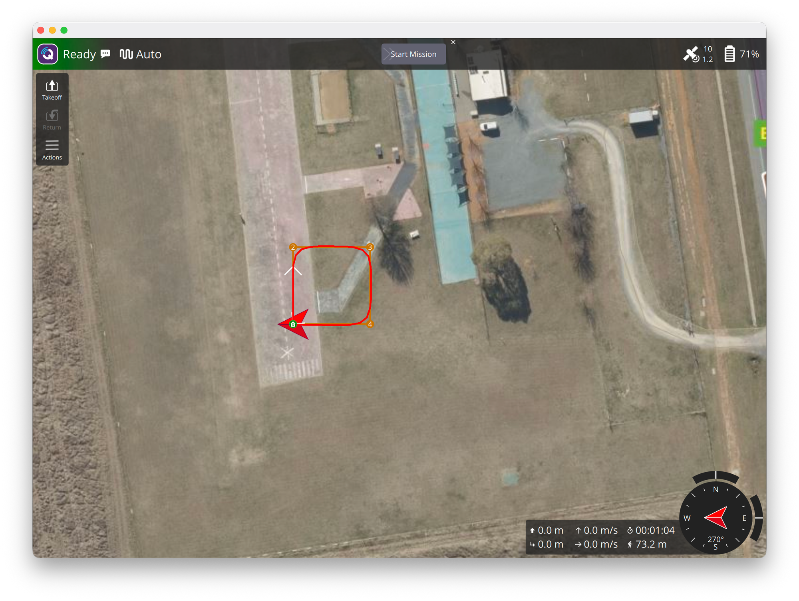
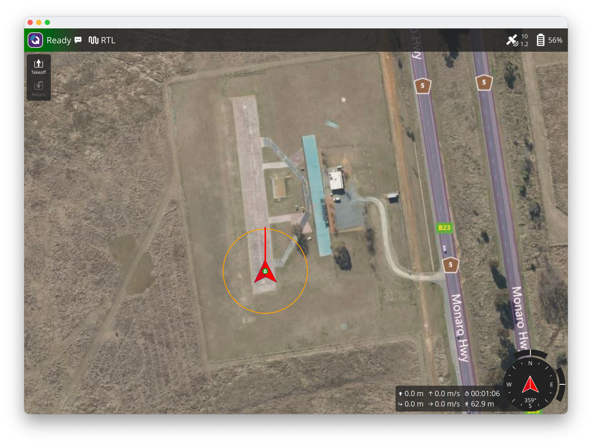
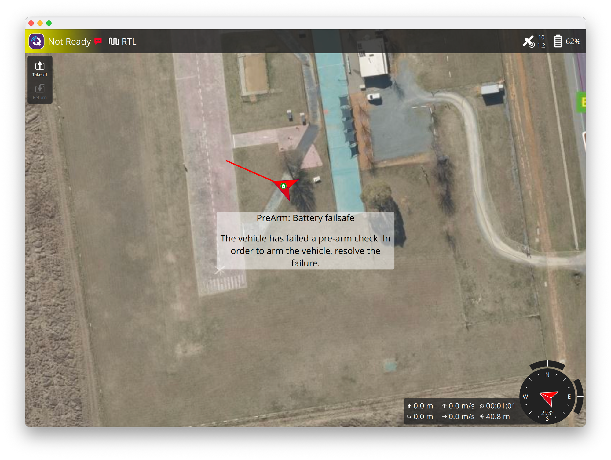

# W06 任務與安全

## 本週要知道

學完能回答：**怎麼把一串航點交給無人機自己飛完？飛出範圍或出狀況時，飛控怎麼自保？**

1. **任務是一份「清單」存在飛控裡**：用 AUTO 模式執行，不是你一直發指令。W5 的 Guided 是「你指揮每一步」，W6 的任務是「先交代好、再放手」。
2. **上傳任務有固定協定**（MAVLink mission protocol）：
   - 你送 `MISSION_COUNT`（共幾項）
   - 飛控逐項回 `MISSION_REQUEST_INT`（要第幾項；SITL 實測 7 次要項目全都是舊版 `MISSION_REQUEST`，回 `MISSION_ITEM_INT` 也被接受）
   - 你回 `MISSION_ITEM_INT`（該項內容）
   - 全部收完，飛控回 `MISSION_ACK`
   - 跟 W4 的 `COMMAND_LONG` 不同：這是**飛控主動來要**，你被動回應
3. **任務項目 = 指令 + 參數 + 座標**：`NAV_TAKEOFF`、`NAV_WAYPOINT`、`NAV_RETURN_TO_LAUNCH`、`NAV_LAND` 等；第 0 項在 ArduPilot 是 home，不能當航點用（需查文件確認細節）。數量上限取決於飛控的儲存空間：SITL 實測 `MISSION_COUNT` 650 可以、651 起回 `MISSION_ACK` type 4（`NO_SPACE`）。
4. **航點之間會減速轉彎還是順過**：一般航點到達判定看 `WP_RADIUS`（速度 `WP_SPD`、加速度 `WP_ACCEL`、轉角加速度 `WP_ACC_CNR`）；spline 航點（`NAV_SPLINE_WAYPOINT`）才會平滑過彎。這是 W5 速度控制轉角減速的答案。
5. **Geofence（地理圍欄）**：用一組 `FENCE_*` 參數設定圓柱範圍（半徑、高度上限）與越界動作（RTL、降落…）；越界時飛控自己處理，不靠你的程式。
6. **Failsafe（故障保護）**：遙控器斷線、地面站斷線、電池低電量、EKF 失效等情況各有參數決定動作，常見是 RTL 或 LAND。
7. **RTL（Return To Launch）**：回到起飛點上空（先爬到 `RTL_ALT`），再降落；也是多數 failsafe 的預設動作。
8. **安全機制是「最後防線」**：先在模擬器故意觸發一次，看到它真的動作，才算理解。

### 可以跳過

- 任務項目的條件與事件指令（`CONDITION_*`、`DO_*` 大全）：用到再查
- Rally point（備降點）與 ArduPilot 的 mission 重新排序細節
- 固定翼與 VTOL 的 failsafe

## 閱讀清單

**必讀**

1. MAVLink 任務協定：<https://mavlink.io/en/services/mission.html>：上傳／下載流程與狀態
2. Auto 模式：<https://ardupilot.org/copter/docs/auto-mode.html>
3. 任務指令一覽（ArduPilot 支援的）：<https://ardupilot.org/copter/docs/common-mavlink-mission-command-messages-mav_cmd.html>
4. RTL 模式：<https://ardupilot.org/copter/docs/rtl-mode.html>
5. Failsafe 總覽：<https://ardupilot.org/copter/docs/failsafe-landing-page.html>

**選讀**

- Geofence：<https://ardupilot.org/copter/docs/common-geofencing-landing-page.html>
- 簡易圍欄設定：<https://ardupilot.org/copter/docs/common-ac2_simple_geofence.html>
- 電池 failsafe：<https://ardupilot.org/copter/docs/failsafe-battery.html>
- 地面站 failsafe：<https://ardupilot.org/copter/docs/gcs-failsafe.html>
- MAVSDK 任務（C++ 指南，Python 用法對照）：<https://mavsdk.mavlink.io/main/en/cpp/guide/missions.html>

## 實作

1. pymavlink 上傳一個正方形任務（起飛 → 四個航點 → RTL），切 AUTO 執行並觀察進度（`MISSION_CURRENT`、`MISSION_ITEM_REACHED`）（腳本：[`scripts/w6_mission_square.py`](../../appendix/scripts/w6_mission_square.md)）
2. 觀察任務協定：只送 `MISSION_COUNT` 不回應會怎樣？（逾時與重送）（腳本：[`scripts/w6_mission_timeout.py`](../../appendix/scripts/w6_mission_timeout.md)）
3. 設圓柱 geofence，用 Guided 往外飛，觀察越界時的動作（腳本：[`scripts/w6_geofence.py`](../../appendix/scripts/w6_geofence.md)）
4. 觸發一種 failsafe（例如地面站斷線或電池低電量），確認飛控自己 RTL（腳本：[`scripts/w6_failsafe_battery.py`](../../appendix/scripts/w6_failsafe_battery.md)，觸發低電量）
5. （選做）用 MAVSDK 的 `mission` 外掛重做實作 1，比較兩者
6. 專案 1：[`projects/waypoint-mission`](../../projects/waypoint-mission.md)，整合以上做成「自動飛正方形並回家」

## 學到什麼

### 實作 1：上傳任務並用 AUTO 執行

- **上傳**：送 `MISSION_COUNT = 7`，飛控依序要第 0–6 項（全部用舊版 `MISSION_REQUEST`），回 `MISSION_ITEM_INT` 即被接受，最後 `MISSION_ACK ACCEPTED`；不到 0.1 秒完成。
- **在地面切 AUTO 不會起飛**：只看到「Mission: 1 Takeoff」，約 10 秒後飛控因為沒離地而自動 disarm；要再送 `MAV_CMD_MISSION_START`。
- **進度**：`MISSION_CURRENT` 是「現在執行第幾項」，`MISSION_ITEM_REACHED` 是「到了第幾項」；整趟約 65 秒（起飛 10 秒、四個角各約 5–7 秒、RTL 含降落約 31 秒）。結束後 `MISSION_CURRENT` 回到第 0 項。
- **圖上看到的**：
  - 起飛（第 1 項）沒有座標，QGC 不畫點；第 5 項就在 Home 上，與 Home 圖示重疊，所以只看到 2、3、4 三個圓點
  - 軌跡的角是**圓角**，飛機沒有飛到航點上才轉彎，而是提早切角（推測與 `WP_RADIUS`、轉角加速度 `WP_ACC_CNR` 有關，沒有驗證）；與 W5 用速度指令時「先減速再轉」的直角完全不同
  - 飛機落地後機頭朝西（羅盤 270°）

### 實作 2：任務協定逾時與重送

腳本：[`scripts/w6_mission_timeout.py`](../../appendix/scripts/w6_mission_timeout.md)。送 `MISSION_COUNT = 3` 之後完全不回應。

- **重送**：飛控每 1 秒重送一次 `MISSION_REQUEST seq=0`，共 8 次（0–7 秒）。
- **放棄**：第 8 秒送 `MISSION_ACK type=15`（`OPERATION_CANCELLED`）與 `STATUSTEXT：Mission upload timeout`，整個上傳作廢。
- **遲到的回應**：逾時後才回 `MISSION_ITEM_INT seq=0`，飛控回 `MISSION_ACK type=1`（`ERROR`），不會接受。
- **意義**：上傳是「飛控主動要、你被動回」，你這邊停了，飛控也不會永遠等；寫程式時收到 `MISSION_ACK` 的 type 不是 0 就得從 `MISSION_COUNT` 重來。

### 實作 3：圓柱 geofence

腳本：[`scripts/w6_geofence.py`](../../appendix/scripts/w6_geofence.md)。設 `FENCE_ENABLE = 1`、`FENCE_TYPE = 3`（高度上限 + 圓）、`FENCE_ACTION = 1`（RTL，不行就 LAND）、`FENCE_RADIUS = 30`（最小值）、`FENCE_ALT_MAX = 20`；起飛到 10 m 後用速度指令往北 3 m/s。

- **QGC 才畫得出圍欄**：圓只在 `FENCE_ENABLE = 1` 時顯示；腳本結束還原參數後圓就消失，截圖要用 `keep` 選項（結束不還原）。
- **越界**：北約 28–30 m 時飛控送出 `Circle fence breached`，GUIDED 變 RTL；慣性讓飛機衝到北約 32.5 m，之後先爬到 15 m（`RTL_ALT`）再飛回 Home，回到圍欄內時送出 `Fence breach cleared`，約 45 秒後落地。
- **三個沒預料到的地方**（一開始都沒觸發越界）：
  1. **Guided 的 goto 目標在圍欄外會被直接拒絕**：飛機完全不動、沒有任何回應。要飛出去只能用速度指令。
  2. **`AVOID_ENABLE` 預設 3（含 `UseFence`）**：速度指令飛到離圍欄約 2 m（北 27.6 m）就被擋下來、停在原地，不會越界。要觀察越界必須把 `AVOID_ENABLE` 設成 0（腳本結束會還原）。
  3. **Home 每次 arm 都會重設**：圍欄圓心是 Home，上次降落在北 28 m 的話，下次 arm 的圍欄圓心就在那裡；要回到起點才能看到同樣的結果（SITL 用重啟）。
- **重啟後剛開機**：EKF 約 20 秒才有位置，這之前切 GUIDED 會出現 `Need Position Estimate`，arm 也會被拒絕，等 `EKF3 IMU0 is using GPS` 即可。

### 實作 4：觸發低電量 failsafe

腳本：[`scripts/w6_failsafe_battery.py`](../../appendix/scripts/w6_failsafe_battery.md)。

- **預設不會動作**：`BATT_FS_LOW_ACT` 預設 0（無），電壓低於 `BATT_LOW_VOLT`（預設 10.5 V）時只會發出警告，不會 RTL；要自己設成 2（RTL）才會自保。
- **怎麼觸發**：SITL 電壓約 12.6 V，把 `BATT_LOW_VOLT` 調到 13.6 V、`BATT_LOW_TIMER` 調到 2 秒（預設 10 秒），不需要等電池真的放電。
- **時間軸**（起點 = 飛到北 30 m、改完參數）：約 2.2 秒後飛控送出 `Battery 1 is low 12.60V used 914 mAh` 與 `Battery Failsafe`，模式從 GUIDED 變 RTL；之後腳本沒有送任何指令，約 43 秒後落地、`Disarming motors`。與 `BATT_LOW_TIMER = 2` 吻合。
- **要還原參數**：腳本結尾用 `finally` 還原三個參數，否則下次起飛就帶著 13.6 V 的門檻，一 arm 就觸發 failsafe。
- **failsafe 會鎖住**：參數還原、飛機也落地了，QGC 仍顯示「Not Ready」與 `PreArm: Battery failsafe`，arm 被拒絕（`Arm: Battery failsafe`，COMMAND_ACK result 4）。要重啟飛控才解除（SITL 用 `MAV_CMD_PREFLIGHT_REBOOT_SHUTDOWN`，param1 = 1）；重啟後 `Accels inconsistent`、`waiting for home` 等開機檢查會暫時出現，等 EKF 準備好。

## 卡在哪

- **在地面切 AUTO 不會起飛**：只看到 `Mission: 1 Takeoff`，約 10 秒後因為沒離地而自動 disarm；要再送 `MAV_CMD_MISSION_START`。
- **goto 在圍欄外被默默拒絕**：飛機不動、沒有任何回應，一度以為是腳本壞掉；要改用速度指令才飛得出去。
- **圍欄一直沒觸發**：`AVOID_ENABLE` 預設就把速度指令擋在圍欄內 2 m；加上 Home 每次 arm 都重設，連續多次不重啟 SITL 時圓心跟著移動。要重現需關掉 `AVOID_ENABLE` 並重啟 SITL。
- **failsafe 觸發後會鎖住**：參數還原、落地後仍 `PreArm: Battery failsafe`，要重啟飛控才解除。
- **重啟飛控後剛開機**：`Need Position Estimate`、`Accels inconsistent`、`waiting for home` 都只是 EKF 還沒好，等約 20 秒。
- **QGC 的圍欄圓只在 `FENCE_ENABLE = 1` 時顯示**：腳本結束還原參數後圓就消失，截圖要用 `keep` 選項。
- **沒解開的疑問**：
  - 軌跡的圓角到底由 `WP_RADIUS` 還是 `WP_ACC_CNR` 決定（只是推測，沒有改參數驗證）。
  - SITL 任務容量 650 是否含 home（`MISSION_COUNT` 650 可、651 起 `NO_SPACE`）。
  - `NAV_SPLINE_WAYPOINT` 實際軌跡長怎樣（沒做）。
  - 只觸發了低電量 failsafe；遙控器斷線、地面站斷線（`FS_GCS_ENABLE`）、EKF 失效沒測。
  - 實作 5（MAVSDK mission）略過，沒有與 pymavlink 比較。

## 下週問題

- W7 Gazebo 在 arm64 macOS 上穩不穩，要用 Docker 還是 Linux VM？ArduPilot 與 Gazebo 怎麼串接（ArduPilot Gazebo plugin、SITL 的 JSON 介面）？
- 模擬裡怎麼加攝影機與距離感測器，資料怎麼送出來（Gazebo transport、ROS 2 bridge）？
- 換成 Gazebo 之後，W5、W6 的 pymavlink 腳本還能不能直接跑（連線埠、`HOME`、物理與 SITL 內建模型的差異）？
- 圍欄與 failsafe 的行為在 Gazebo 裡會不會不同（例如電池模型）？
