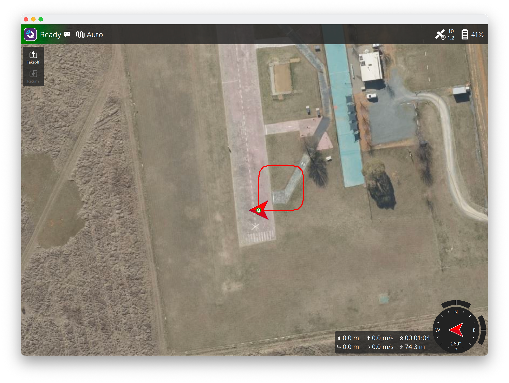

# 專案 1：waypoint-mission

W6 專案：**自動飛正方形並回家**，並在安全參數（geofence、低電量 RTL）到位的前提下執行。

腳本：[`scripts/w6_waypoint_mission.py`](../appendix/scripts/w6_waypoint_mission.md)

## 目標與驗收

- 起飛 10 m，依序飛過邊長 20 m 正方形的四個角（北 20 m 起順時針），RTL 回家。
- 全程不手動介入：只啟動 SITL，再執行一支腳本。
- 驗收（腳本最後會印出）：
  - 任務項目 2–5（四個角）都有 `MISSION_ITEM_REACHED`
  - 落地點離 Home 不超過 3 m
  - 任務在 300 秒內結束，且結束後參數已還原

## 流程

1. **設安全參數**：圍欄半徑 50 m、高度上限 20 m、越界 RTL（`FENCE_*`）；低電量 RTL（`BATT_FS_LOW_ACT = 2`）。這是實作 3、4 的結果。
2. **上傳任務**：7 項（home、`TAKEOFF`、四個角、`RTL`），依任務協定逐項回應（實作 1、2）。
3. **arm → AUTO → `MISSION_START`**：在地面切 AUTO 不會自己起飛，要再送 `MISSION_START`。
4. **觀察**：記錄到達的項目與離 Home 的最大距離，直到 disarm。
5. **驗收並還原參數**：用 `finally` 保證參數一定設回。

## 實測結果

```
耗時 64 秒；到達項目 [1, 2, 3, 4, 5, 6]；最遠離 Home 26.6 m；落地點離 Home 0.0 m
結果：通過
```



- 飛行距離 74.3 m：四邊共 80 m，圓角切掉約 6 m。
- 四個角之間約 5–7 秒，起飛約 10 秒，RTL（含降落）約 30 秒。
- **最遠只離 Home 26.6 m**，比正方形對角的 28.3 m 近：軌跡在角上是圓角，沒有飛到航點上才轉彎（見 W6 筆記實作 1）。
- 圍欄半徑 50 m 遠大於正方形，全程沒有觸發；圍欄與低電量 failsafe 在這裡只是「最後防線」。

## 可以再做

- 把 `NAV_WAYPOINT` 換成 `NAV_SPLINE_WAYPOINT`，比較軌跡（W6 筆記提到但沒有實測）。
- 縮小圍欄到 30 m（最小值）並把邊長改成 30 m，看圍欄會不會在任務中途接手。
